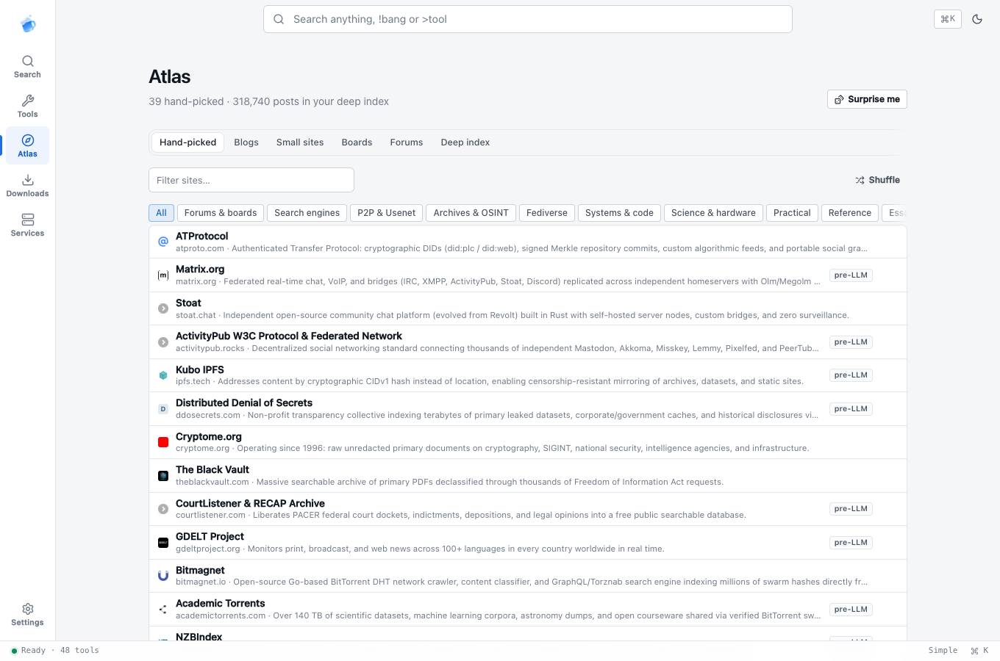

<div align="center">


# glogg

**The whole web, minus the junk.**

A self-hosted search workbench: answers first, real sites instead of ads and SEO filler,<br />
its own index of the small web, imageboards and forums, and the tools you reach for after a search.

[Install](#install) · [Using it](#using-glogg) · [Configuration](#configuration) · [Security](#security) · [API](./docs/api.md) · [Contributing](./CONTRIBUTING.md)

</div>


## What it does

- **Search that skips the junk.** glogg asks 20+ sources at once: SearXNG, Marginalia, Mwmbl, Wikipedia, Stack Exchange, Hacker News, Lobsters, Lemmy, Bluesky, Mastodon, OpenAlex, arXiv, GitHub, chan archives, old forums, torrents and Usenet.
  - It hides sponsored, affiliate and SEO-farm pages, collapses copies of the same page and keeps any one site from taking over the results.
  - It puts official docs, accepted answers and first-hand posts on top.
- **Answers first.** Calculations, conversions, accepted answers and facts sit above the results.
  - In the Advanced view, **Research** reads the top pages and writes an answer with numbered citations. It uses your own model (Ollama, LM Studio, or an API key), or quotes the pages when there's no model.
- **Its own index of the obscure web.** About 56,000 personal blogs, imageboards and forums, crawled politely and searched on your machine in milliseconds:
  - Kagi Small Web, the 512KB Club and the XXIIVV webring;
  - 4chan, 2ch, lainchan, wizchan and more;
  - 9,800 Lemmy communities, about 950 Discourse forums and 100 Stack Exchange sites.
- **Tools after the search.** Send a torrent or link to Real-Debrid, TorBox or Offcloud, an NZB to SABnzbd, a file to Nextcloud or pCloud. Look up DNS, WHOIS and TLS; test a website's security headers. Every tool is a plugin folder, and adding one takes no front-end code.
- **Yours.**
  - It runs on your machine or your server.
  - Keys stay on the server and are never sent to the browser.
  - No telemetry. The page loads nothing from third parties except site icons, which come from DuckDuckGo's icon service.
  - A password protects it on a public address.

<table>
  <tr>
    <td></td>
    <td></td>
  </tr>
</table>

## Install

### Docker Compose

The quickest way to run glogg on your own machine. You need Docker with Compose.

```bash
git clone https://github.com/WCKDai/glogg.git
cd glogg
docker compose up -d
```

Open <http://localhost:4173>.

- **Better web results:** run a private SearXNG next to it with `docker compose --profile searxng up -d`. glogg is already pointed at it.
- **Update:** `git pull && docker compose up -d --build`.
- **Your data:** settings, keys and the deep index are in the `glogg-data` volume. To back it up, run `docker run --rm -v glogg_glogg-data:/data -v "$PWD":/backup alpine tar czf /backup/glogg-data.tgz -C /data .`
- **Settings:** optional; copy [`.env.example`](./.env.example) to `.env` and set what you need.

glogg answers only on this machine (`127.0.0.1`). To use it from your phone or other computers:

1. Set a password in `.env`: `GLOGG_PASSWORD=` followed by a long passphrase.
2. In `docker-compose.yml`, change `"127.0.0.1:${GLOGG_PORT:-4173}:4173"` to `"${GLOGG_PORT:-4173}:4173"`.
3. If you reach it by a name rather than an IP address, add `GLOGG_ALLOWED_HOSTS=glogg.home.example` to `.env`.

Then run `docker compose up -d` again.

### Coolify

[Coolify](https://coolify.io) gives glogg a domain with HTTPS and a generated password in a few clicks:

1. **New Resource** → **Public Repository** (or **Private Repository** for your fork), and enter this repository.
2. **Build Pack: Docker Compose**. Set **Docker Compose Location** to `/docker-compose.coolify.yml`.
3. **Deploy.** Coolify builds glogg and a private SearXNG, then gives glogg a domain with HTTPS. To use your own domain, set it under the glogg service's **Domains**, keeping the `:4173` port at the end.
4. Sign in with the password from **Environment Variables** → `SERVICE_PASSWORD_GLOGG`.

What [`docker-compose.coolify.yml`](./docker-compose.coolify.yml) sets up:

- **Network:** no ports are published on the server. Only Coolify's proxy reaches glogg, over HTTPS, and glogg answers only under its own domain.
- **Sign-in:** every page and API call needs a session from the generated password. Cookies are Secure, HttpOnly and SameSite=Strict, and wrong passwords are rate-limited.
- **Containers:** the root filesystem is read-only except the data volume, all Linux capabilities are dropped, and `no-new-privileges` is on. glogg runs as an unprivileged user.
- **SearXNG** runs next to glogg, unpublished, with a generated secret.

### From source

For development, or to run glogg directly on a machine. You need Node.js 22.13 or newer.

```bash
git clone https://github.com/WCKDai/glogg.git
cd glogg
npm install
npm run dev     # http://localhost:4173, reloads as you edit
```

`npm run build && npm start` runs the production build. Run that way, glogg can also start optional services next to it from its **Services** page:

- SearXNG
- Bitmagnet (a DHT torrent index)
- Kubo IPFS
- aria2
- Prowlarr
- NZBHydra2
- Nextcloud

These come from [`infra/docker-compose.services.yml`](./infra/docker-compose.services.yml) (or `npm run services:up`). Their admin ports listen on this machine only.

#### Browser extension

`npm run build:extension`, then load `dist-extension/` as an unpacked extension (`chrome://extensions` → Developer mode → Load unpacked). It strips sponsored results and SEO farms from Google, DuckDuckGo, Brave and Bing, and marks primary and independent sources.

## Using glogg

glogg has two views:

- **Simple:** one search box and one column of answers and sites.
- **Advanced:** adds a rail with scopes, sources and filters, the ranking signals behind each result, and Research.

Switch with <kbd>m</kbd>.

| Do this | How |
| :--- | :--- |
| Search another engine | Put a bang anywhere in the query: `!w turing`, `!gh ripgrep`, `!4p thinkpad`. There are 50+ built in; add your own in Settings. |
| Run a tool | Type `>` and a trigger: `>dns example.com`, `>whois example.com`, `>headers example.com`, `>hash text`, `>rd magnet:?…` |
| Do anything else | <kbd>⌘K</kbd> / <kbd>Ctrl K</kbd>: views, scopes, toggles, every tool |
| Narrow the search | Scopes: All, Wild West (imageboards, chan archives, old forums), Forums, Small Web, Docs & Papers, Fediverse, Archives, News, Torrents, Usenet |
| Move through results | <kbd>/</kbd> search · <kbd>j</kbd> <kbd>k</kbd> move · <kbd>↵</kbd> open · <kbd>r</kbd> read clean · <kbd>d</kbd> send to downloads |
| See what was asked | The status bar shows how many sources answered and how fast; click it for each source |
| Unfiltered results | Settings → 18+ mode (it asks you to confirm). The 18+ pill in the sidebar turns it off. |

**Downloads.** **Send** routes a torrent, NZB or page to the first destination that's set up: Offcloud, aria2, Nextcloud, then this machine. Configured debrid, storage and Usenet plugins (Real-Debrid, TorBox, pCloud, SABnzbd) appear as destinations too. Keys go in Settings → Integrations, and are stored server-side (mode 600) and masked in the browser.

**Tools and plugins.** Every tool is a plugin: a folder with an `index.mjs`. The built-in ones are in `plugins/` (as TypeScript); yours go in `~/.glogg/plugins/` (`/data/plugins` in Docker) and survive updates.

- A plugin declares settings, tools with typed inputs and an optional `>trigger`, and optionally a container and a download hand-off.
- Tools return generic blocks (tables, key/value lists, checklists, code, buttons), so a new tool needs no front-end code.
- Start from [`plugins/_template`](./plugins/_template/index.mjs) and press **Reload** on the Tools page.

| Area | Built in |
| :--- | :--- |
| Debrid | Real-Debrid, TorBox, Offcloud |
| Cloud storage | Nextcloud, pCloud |
| Usenet | NZB.life, SABnzbd |
| OSINT | DNS, WHOIS/RDAP, subdomains, IP intel, username footprint, Wayback history, reverse image search, dork builder |
| Website testing | Security headers, TLS certificate, PageSpeed, SEO and meta tags, broken links, tech stack, email security, response time |
| Utilities | Hashes, encode/decode, JWT, timestamps, UUIDs, magnet inspector |
| AI | Your own key or a local model: Ollama, LM Studio, OpenAI, Anthropic, OpenRouter, Groq, Mistral, DeepSeek, Together, any OpenAI-compatible endpoint |

### The deep index

Big search engines rank by popularity, so personal blogs, imageboard threads and forum posts rarely surface. glogg keeps its own index of them and searches it on every query.

| Kind | Where it comes from | How it's read |
| :--- | :--- | :--- |
| Blogs | [Kagi Small Web](https://github.com/kagisearch/smallweb) (≈43,000, MIT), [XXIIVV webring](https://webring.xxiivv.com) members with a feed | RSS, Atom or JSON Feed, daily |
| Small sites | [512KB Club](https://512kb.club) (≈960, MIT), the rest of the XXIIVV webring | the feed found on the page |
| Imageboards | every 4chan board, 2ch, lainchan, leftypol, uboachan, sushigirl, wizchan, kissu | board catalogs, hourly; text only, 18+ boards only in 18+ mode |
| Forums | ≈9,800 [Lemmy](https://lemmyverse.net) communities, ≈950 Discourse forums ([Discourse Discover](https://discover.discourse.org)), 100 Stack Exchange sites, VOGONS, VCFed, Lobsters, Tildes | feeds every 3–12 hours |
| Yours | any URL you add in Atlas → Deep index | detected: feed, Discourse forum, board catalog, or a page with a feed |

**Crawling is off until you start it** (Atlas → Deep index → Build the deep index). Then it runs in the background and survives restarts:

- one request per site at a time, at least a second apart;
- conditional requests, so an unchanged feed costs a `304`;
- `Retry-After` respected, and failing sources backed off for up to a week.

A first full pass takes roughly 3–4 hours and 1–1.5 GB, stored in `deep.db` in glogg's data folder. Results show up as they arrive.

Sources whose names advertise sexual material involving minors, and posts using the jargon for trading it, are never indexed, in any mode ([`server/deep/blocklist.ts`](./server/deep/blocklist.ts)).

## Configuration

Everything is optional. In Docker, put these in `.env` (see [`.env.example`](./.env.example)); from source, export them.

| Variable | Default | What it does |
| :--- | :--- | :--- |
| `GLOGG_PASSWORD` | unset | Require this password to use glogg; see [Security](#security) |
| `GLOGG_PASSWORD_FILE` | unset | Read the password from a file, such as a Docker secret |
| `GLOGG_ALLOWED_HOSTS` | | Host names or URLs glogg may be reached under, besides `localhost` and IP addresses (`*` turns the check off) |
| `GLOGG_ALLOWED_ORIGINS` | | Other origins allowed to call the API |
| `GLOGG_TRUST_PROXY` | private networks | Proxies whose `X-Forwarded-For` / `-Proto` glogg believes (Express syntax: `1`, `true`, a subnet) |
| `HOST`, `PORT` | `0.0.0.0`, `4173` | Where glogg listens (from source; Docker publishes on `127.0.0.1`) |
| `GLOGG_HOME` | `~/.glogg` (`/data` in Docker) | Settings, keys, plugins and the deep index |
| `GLOGG_DOWNLOADS_DIR` | `~/Downloads/glogg` | Where Send saves files when nothing else is set up |
| `SEARXNG_URL` | `http://localhost:8080` | Your SearXNG (Docker Compose sets its own) |
| `BITMAGNET_URL`, `IPFS_GATEWAY_URL`, `TORZNAB_URL`, `NEWZNAB_URL` | local ports | Other self-hosted backends |
| `MARGINALIA_API_KEY`, `STACKEXCHANGE_KEY` | shared keys | Personal keys raise rate limits (Stack Exchange: 10,000 requests a day instead of 300) |
| `GLOGG_CONTAINER_RUNTIME` | `auto` (`none` in Docker) | `docker`, `podman`, or `none` to never run either |

<details>
<summary>Search timing</summary>

A search asks every source at once and returns as soon as the main sources for the scope have answered, plus a short grace period for quick small-web sources. Later results are picked up without reordering what you're reading. Repeat searches come from a 10-minute cache, and a source that keeps hanging rests for five minutes.

| Variable | Default | What it does |
| :--- | :--- | :--- |
| `GLOGG_CORE_GRACE_MS` | `500` | Wait after the main sources answer, for quick extra ones |
| `GLOGG_MIN_WAIT_MS` | `1000` | Earliest a search returns through the grace rule |
| `GLOGG_SOURCE_DEADLINE_MS` | `2000` | Stop waiting once the main sources have enough results |
| `GLOGG_HARD_DEADLINE_MS` | `7000` | Never wait longer than this |
| `GLOGG_ANSWER_BUDGET_MS` | `2200` | How long an instant answer may take |
| `GLOGG_CACHE_TTL_MS` | `600000` | Per-source result cache (`0` turns it off) |
| `GLOGG_SOURCE_REST_MS` | `300000` | How long a source that hung twice is skipped |
| `GLOGG_TOOL_TIMEOUT_MS` | `45000` | Longest a plugin tool may run |
| `GLOGG_HAPPY_EYEBALLS` | unset | glogg connects IPv4-first; `1` restores Node's default, which fails many parallel requests on networks without IPv6 |

</details>

## Security

glogg holds your keys (debrid, cloud storage, AI) and can run tools, so it guards its API.

**On your own machine** it needs no password, but other websites can't use it:

- The API answers glogg itself, browser extensions and local tools (curl, the CLI). Requests from other sites are refused.
- A `Host` check stops DNS-rebinding pages from posing as glogg.
- Docker Compose publishes glogg on `127.0.0.1` only.

**On a network or a public address, set a password** (`GLOGG_PASSWORD`, or `GLOGG_PASSWORD_FILE`). The Coolify setup does this for you.

- Every route except health and sign-in then needs a session, including search.
- Sessions are HttpOnly, SameSite=Strict cookies, Secure over HTTPS, valid for 30 days. They're signed with a key derived from the password and a random secret in glogg's data folder, so changing the password signs everyone out.
- Ten wrong passwords lock an address out for 15 minutes.
- If the password file can't be read, glogg refuses to start rather than run open.

Behind a reverse proxy, glogg believes forwarded addresses only from private-network proxies, so the rate limit can't be dodged from outside.

Page text is treated as untrusted: Research tells the model never to follow instructions found in sources. To report a vulnerability, see [SECURITY.md](./SECURITY.md).

## Development

```bash
npm run dev            # server and client with hot reload
npm run check          # typecheck
npm test               # all suites, offline
npm run test:perf      # speed suite, printing timings
npm run build          # web app and browser extension
npm run check:bundle   # gzipped client size budget (JS 125 KB, CSS 16 KB)
npm run cli -- search "ubuntu linux" --lens forums
```

The suites cover:

- **Ranking:** quality goldens (junk hidden, docs and accepted answers on top, variety kept).
- **Instant answers and Research:** the answer engine and Research with stubbed pages and models.
- **Search pipeline:** source timing and deadlines.
- **Deep index:** parsers for every directory, the store, crawler politeness and the blocklist.
- **Security:** the request guard and password protection.
- **Plugins:** plugins and their tools.
- **UI:** flows in jsdom.
- **Speed:** budgets for the client.

[CONTRIBUTING.md](./CONTRIBUTING.md) maps the code and explains how to add a source or a plugin. [docs/api.md](./docs/api.md) lists every endpoint.

## License

[MIT](./LICENSE). The deep index's directories keep their own licences: Kagi Small Web and the 512KB Club are MIT. Lemmyverse, Discourse Discover and the XXIIVV webring are public lists, read politely. glogg indexes only text, and links to the original pages.
