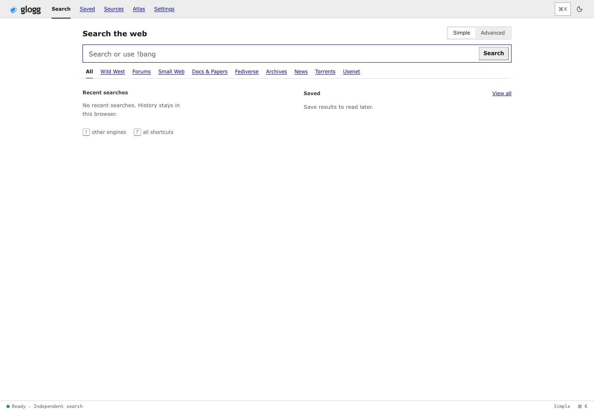
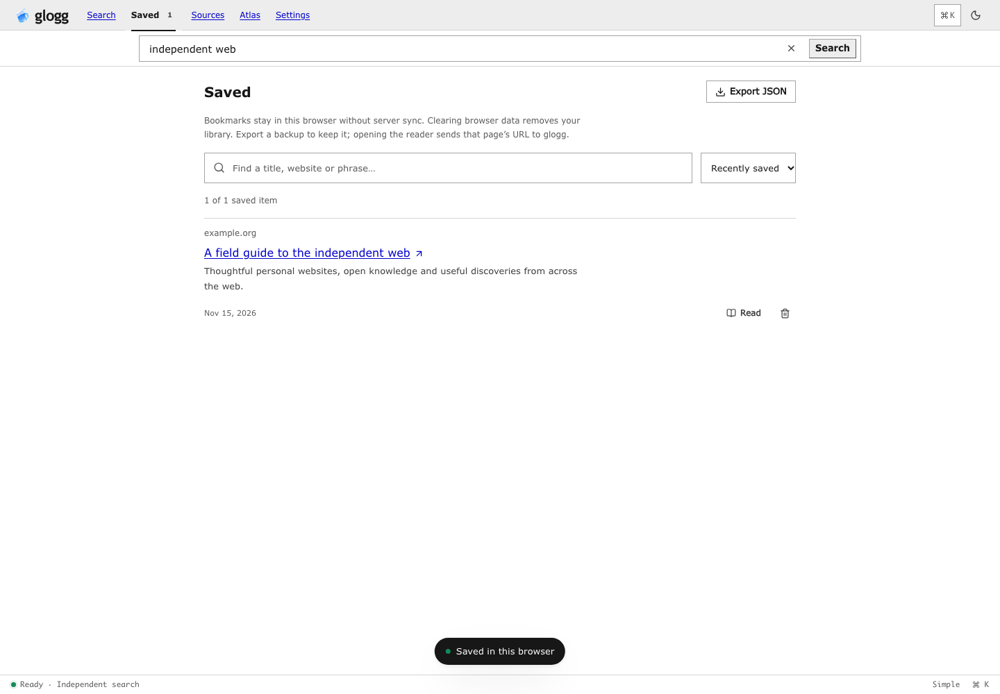
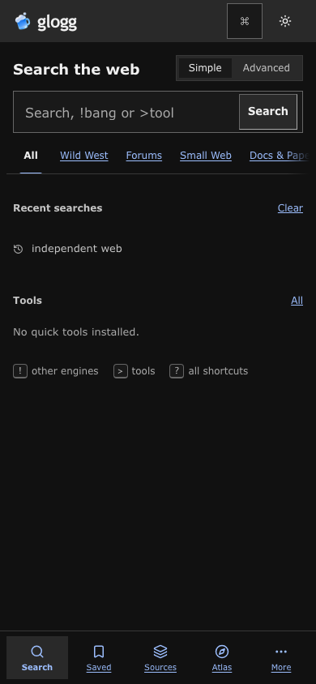
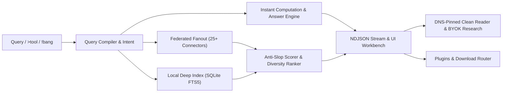

<div align="center">


# glogg

**The whole web, minus the junk.**

A fast, self-hosted search engine and research workbench: instant answers & calculations, anti-slop ranking across 25+ sources, a local SQLite FTS5 deep index of ~56,000 small-web blogs, forums and imageboards, a clean reader, BYOK synthesis, and a zero-telemetry plugin toolkit.

[](https://glogg.app)
[](https://github.com/WCKDai/glogg/actions/workflows/ci.yml)
[](./LICENSE)
[](./package.json)
[](./docs/install.md)

[**Try glogg.app**](https://glogg.app) · [Install](#install) · [Usage](./docs/usage.md) · [Deep Index](#the-deep-index) · [Plugins](./docs/plugins.md) · [Public Service](./docs/public-service.md) · [API](./docs/api.md) · [Contributing](./CONTRIBUTING.md)

</div>



## Why glogg?

Modern web search buries primary documentation, practitioner blogs, and real forum discussions beneath SEO listicles, affiliate roundups, and AI-rewritten content mills. **glogg** fixes both sides of the problem:

- **Signal-first meta-search across 25+ connectors.** Queries SearXNG, Marginalia, Mwmbl, Wiby, Wikipedia, Wikimedia Commons (Images & Videos), Stack Exchange, Hacker News, Lobsters, Lemmy, Bluesky, Mastodon, Matrix, OpenAlex, Crossref, Europe PMC, arXiv, Open Library, GitHub, GDELT, Internet Archive, chan archives, old-school forums, BitTorrent DHT, and Usenet concurrently — streaming the first useful batch over NDJSON in ~300–650 ms while slower sources settle without reshuffling what you are reading.
- **Deterministic anti-slop scoring & diversity ranking.** Penalizes content farms, affiliate boilerplate, and monoculture mega-domains; deduplicates syndication copies; enforces per-domain caps (`1` / `2` / `3` / `∞`); elevates official docs, accepted answers, RFCs, primary papers, and independent sites; and supports time-range filtering (`24h`, `7d`, `30d`, `1y`) plus query-term snippet highlighting.
- **Instant answers & zero-latency workbench calculations.** Evaluates math, scientific/bitwise expressions (`sqrt(2)`, `1 << 10`), percentages, base conversions, 55+ physical & binary unit conversions (`100 C in F`, `5 GiB in MB`), CSS colors (`#ff5733`, `rgb(...)`, `hsl(...)`) with live swatch & WCAG AA contrast ratios, IPv4 CIDR subnets (`192.168.1.0/24`), Unix/ISO timestamps, HTTP status codes (`http 418`), and cron expressions (`*/15 9-17 * * 1-5`) — plus accepted Stack Exchange answers and subject-aligned Wikipedia extracts.
- **Local SQLite FTS5 Deep Index (~56,000 sources).** Politely crawls personal blogs (Kagi Small Web, 512KB Club, XXIIVV webring), imageboards (4chan, 2ch, lainchan, wizchan…), ~9,800 Lemmy communities, ~950 Discourse forums, and 100 Stack Exchange sites into a local full-text database (`deep.db`) with `site:`, `-word`, `"exact phrase"`, time-range filtering, instant single-source indexing, and OPML import/export.
- **Clean Reader, BYOK Research & Post-Search Tools.** Strip trackers and clutter with the DNS-pinned SSRF-safe reader (<kbd>r</kbd>), synthesize cited answers with your own local or remote model (Ollama, LM Studio, OpenAI, Anthropic, OpenRouter…), bookmark pages locally with offline PWA support, and route links or magnets to Real-Debrid, TorBox, Offcloud, SABnzbd, aria2, Nextcloud, or pCloud.
- **Private Workbench or Hardened Public Service.** Run `GLOGG_MODE=private` (default) as your personal search workbench, or `GLOGG_MODE=public` (powering [glogg.app](https://glogg.app)) to serve public search, clean reading, media discovery, and read-only Atlas directories with zero administrative surface exposed.

<table>
  <tr>
    <td></td>
    <td width="28%"></td>
  </tr>
</table>

## Architecture



## Install

### Quick start (Docker Compose)

```bash
git clone https://github.com/WCKDai/glogg.git
cd glogg
docker compose up -d
# Or bundle a private SearXNG meta-node alongside glogg:
docker compose --profile searxng up -d
```

Open <http://localhost:4173>.

- **Your data:** settings, keys, and `deep.db` live in the `glogg-data` volume (see [backing up and restoring](./docs/install.md#your-data)).
- **Configuration:** copy [`.env.example`](./.env.example) to `.env` and uncomment only what you need.
- **LAN / remote access:** glogg binds to `127.0.0.1` by default. Before publishing to another interface, set `GLOGG_PASSWORD` (and `GLOGG_ALLOWED_HOSTS` if reached by hostname).

### Quick start (Node.js 22.13+)

```bash
git clone https://github.com/WCKDai/glogg.git
cd glogg
npm install
npm run build
npm start        # production server on http://127.0.0.1:4173
```

For hot-reloading development, run `npm run dev`. See the full [install guide](./docs/install.md) for macOS/Linux/Windows Docker setups, Podman, `systemd`/`launchd` services, reverse proxies, and optional companion containers (`npm run services:up` for SearXNG, Bitmagnet, Kubo IPFS, aria2, Prowlarr, NZBHydra2, and Nextcloud).

### Public search service (`GLOGG_MODE=public`)

To host a multi-user public search instance like [glogg.app](https://glogg.app), use [`docker-compose.public.yml`](./docker-compose.public.yml) and follow [`docs/public-service.md`](./docs/public-service.md):

```bash
GLOGG_ALLOWED_HOSTS=search.example.com docker compose -f docker-compose.public.yml up -d --build
```

Public mode disables administration, plugins, downloads, private keys, and caller-supplied upstream endpoints at startup while enforcing bounded search, API, reader, and icon concurrency (`HTTP 503` + `Retry-After` under overload).

### Coolify (1-click HTTPS + password)

Point a **Docker Compose** resource in [Coolify](https://coolify.io) at this repository with Compose location `/docker-compose.coolify.yml`. Coolify provisions HTTPS, a private SearXNG container, read-only container hardening, and a generated `SERVICE_PASSWORD_GLOGG`.

### Browser extension (Manifest V3)

```bash
npm run build:extension
```

Load `dist-extension/` unpacked in Chrome, Brave, Edge, or Vivaldi (`chrome://extensions` → **Developer mode** → **Load unpacked**). Works standalone without a glogg server to hide sponsored/SEO-slop results and badge primary & indie sources on Google, DuckDuckGo, Brave Search, and Bing.

## Using glogg

Switch between **Simple** (clean single-column search + instant time filter) and **Advanced** (scope & source rail, ranking telemetry per result, and cited Research synthesis) anytime with <kbd>m</kbd>. Full walkthrough in [`docs/usage.md`](./docs/usage.md).

| Action | Shortcut / Syntax |
| :--- | :--- |
| **Search operators** | `site:sqlite.org`, `-site:pinterest.com`, `-pinterest`, `"exact phrase"` |
| **Time filter** | Filter to **Past 24h**, **Past week**, **Past month**, or **Past year** in the status line, Advanced rail, Command Palette, or `?time=week` |
| **Instant calculations** | `100 C in F` · `5 GiB in MB` · `15% of 240` · `#ff5733` · `192.168.1.0/24` · `http 418` · `*/15 9-17 * * 1-5` · `1700000000` |
| **Bangs (50+ built-in + custom)** | `!w turing` · `!gh ripgrep` · `!arch systemd` · `!hn sqlite` |
| **Inline plugin tools** | `>dns example.com` · `>whois example.com` · `>headers example.com` · `>hash text` · `>rd magnet:?…` |
| **Command palette** | <kbd>⌘K</kbd> / <kbd>Ctrl K</kbd> — live calculator, scopes, time filters, domain rules, tools, settings |
| **Result navigation** | <kbd>/</kbd> focus search · <kbd>j</kbd>/<kbd>k</kbd> move · <kbd>↵</kbd> open · <kbd>r</kbd> clean reader · <kbd>d</kbd> send to downloads · <kbd>?</kbd> all shortcuts |
| **Domain curation** | Result `⋯` menu → **More from domain**, **Pin**, **Raise**, **Lower**, **Hide**, or **Copy Markdown** (uBlacklist-compatible import/export in Settings) |
| **Scopes (Lenses)** | `All` · `Images` · `Videos` · `Wild West` · `Forums` · `Small Web` · `Docs & Papers` · `Fediverse` · `Archives` · `News` · `Torrents` · `Usenet` |

### Command-line interface (`glogg`)

```bash
npm run cli -- search "sqlite wal mode" --lens docs --time year
npm run cli -- inspect https://sqlite.org/wal.html
npm run cli -- deep status
npm run cli -- deep add https://jvns.ca/atom.xml --crawl
npm run cli -- deep opml-export > feeds.opml
npm run cli -- deep opml-import feeds.opml
```

### Built-in plugin ecosystem

Every tool is a self-contained folder under [`plugins/`](./plugins) (built-in) or `~/.glogg/plugins/` (custom, survives upgrades) returning typed UI blocks without custom frontend code. Copy [`plugins/_template`](./plugins/_template/index.mjs) and see [`docs/plugins.md`](./docs/plugins.md).

| Category | Built-in Integrations & Tools |
| :--- | :--- |
| **Debrid & Cloud** | Real-Debrid, TorBox, Offcloud, Nextcloud, pCloud |
| **Usenet & P2P** | NZB.life, SABnzbd, aria2, Bitmagnet, Torznab / Newznab, Magnet Inspector |
| **OSINT** | DNS records, WHOIS/RDAP, Subdomains, IP Intel, Username Footprint, Wayback History, Reverse Image Search, Dork Builder |
| **Web & Security** | Security Headers, TLS Certificate Inspector, PageSpeed, SEO/Meta Audit, Broken Links, Tech Stack Fingerprinter, Email Auth (SPF/DMARC), Response Timing |
| **Developer Utilities** | Hashes, Base64/URL Encode-Decode, JWT Inspector, Timestamps, UUID Generator |
| **BYOK AI** | Ollama, LM Studio, OpenAI, Anthropic, OpenRouter, Groq, Mistral, DeepSeek, Together, or any OpenAI-compatible endpoint |

### The deep index

Big search engines weight backlinks and ad inventory, leaving personal blogs, niche forums, and imageboard threads invisible. glogg maintains its own local SQLite FTS5 index (`deep.db`) and queries it in single-digit milliseconds alongside live connectors:

| Kind | Curated Directories | Crawl Cadence |
| :--- | :--- | :--- |
| **Blogs** | [Kagi Small Web](https://github.com/kagisearch/smallweb) (~43,000, MIT), [XXIIVV webring](https://webring.xxiivv.com) | RSS / Atom / JSON Feed, daily |
| **Small sites** | [512KB Club](https://512kb.club) (~960, MIT), XXIIVV members | Discovered feed, daily |
| **Imageboards** | 4chan, 2ch, lainchan, leftypol, uboachan, sushigirl, wizchan, kissu | JSON catalogs, hourly (18+ boards gated behind 18+ mode) |
| **Forums** | ~9,800 [Lemmy](https://lemmyverse.net) communities, ~950 [Discourse](https://discover.discourse.org) forums, 100 Stack Exchange sites, VOGONS, VCFed, Lobsters, Tildes | Feeds every 3–12 hours |
| **Yours** | Add any URL or **Import/Export OPML** in Atlas → Deep index (or `glogg deep`) | Auto-detected feed, Discourse forum, or board catalog |

Crawling is **opt-in** (Atlas → Deep index → **Build the deep index**), paced to at most 1 request/sec per host, uses conditional HTTP (`ETag` / `If-Modified-Since` → `304`), honors `Retry-After`, and enforces a strict safety blocklist ([`server/deep/blocklist.ts`](./server/deep/blocklist.ts)) in every mode.

## Configuration

All settings are optional. Copy [`.env.example`](./.env.example) to `.env` for Docker Compose, or export environment variables when running from source.

| Variable | Default | Purpose |
| :--- | :--- | :--- |
| `GLOGG_MODE` | `private` | `private` (full personal workbench) or `public` (hardened multi-user search service; see [`docs/public-service.md`](./docs/public-service.md)) |
| `GLOGG_PASSWORD` / `GLOGG_PASSWORD_FILE` | unset | Require authentication for every route except `/api/health` and sign-in |
| `GLOGG_ALLOWED_HOSTS` | localhost & IPs | Additional hostnames/URLs allowed by the DNS-rebinding `Host` guard |
| `GLOGG_ALLOWED_ORIGINS` | same-origin | Additional CORS origins (e.g., `chrome-extension://<id>`) |
| `GLOGG_TRUST_PROXY` | `loopback` (`uniquelocal` in Docker) | Trusted reverse-proxy addresses for `X-Forwarded-For` / `X-Forwarded-Proto` |
| `HOST` / `PORT` | `127.0.0.1` / `4173` | Bind address and HTTP port (`GLOGG_PORT` controls host port in Compose) |
| `GLOGG_HOME` / `GLOGG_DOWNLOADS_DIR` | `~/.glogg` / `~/Downloads/glogg` | Data directory (`/data` in Docker) and local download folder |
| `SEARXNG_URL`, `BITMAGNET_URL`, `IPFS_GATEWAY_URL` | local ports | Self-hosted search & P2P backends |
| `MARGINALIA_API_KEY`, `STACKEXCHANGE_KEY`, `BRAVE_API_KEY` | unset | Optional provider keys for higher rate limits or Brave Web Search API |
| `TORZNAB_URL`/`_API_KEY`, `NEWZNAB_URL`/`_API_KEY`, `NZBLIFE_URL`/`_API_KEY` | unset | Private torrent & Usenet indexers (`private` mode only) |
| `GLOGG_CORE_GRACE_MS` / `GLOGG_MIN_WAIT_MS` | `280` / `650` | Grace window (ms) after core connectors settle and minimum early-return floor |
| `GLOGG_SOURCE_DEADLINE_MS` / `GLOGG_HARD_DEADLINE_MS` | `2000` / `7000` | Soft core-quorum deadline and hard per-search deadline (ms) |
| `GLOGG_TELEMETRY_TOKEN` | unset | Bearer token (`>=16` chars) required to read query-free `GET /api/telemetry` in `public` mode |

## Security

- **Local-first & zero third-party requests.** Listens on `127.0.0.1` by default, serves system fonts, proxies favicons through `/api/favicon/:domain` and Commons thumbnails through `/api/media/image`, sets `Referrer-Policy: no-referrer`, and enforces a strict hash-locked Content Security Policy (`frame-ancestors 'none'`).
- **DNS-pinned SSRF protection.** Reader, Research, and Deep Index fetches resolve each redirect hop once, reject private/loopback/link-local/metadata IP ranges (including mixed public/private DNS responses), and pin the socket to the validated IP while preserving TLS SNI (`GLOGG_ALLOW_PRIVATE_FETCH=1` overrides in `private` mode only).
- **Server-confined secrets & session security.** Provider keys live on disk with mode `0600`, never appear in browser responses or unauthenticated `GET /api/search` calls, and password sessions use `HttpOnly`, `SameSite=Strict`, `Secure` HMAC-signed cookies with server-side revocation and brute-force lockouts.
- **Vulnerability disclosure.** Please report security issues privately via [GitHub Security Advisories](https://github.com/WCKDai/glogg/security/advisories/new) or **boy@wckd.cc** — see [`SECURITY.md`](./SECURITY.md).

## Development

```bash
npm run dev               # hot-reloading server + Vite client on http://localhost:4173
npm run check             # strict TypeScript check (tsc --noEmit)
npm run build             # build client + PWA shell (dist/) and MV3 extension (dist-extension/)
npm run benchmark:search  # offline 31-case NDCG@5 & anti-slop search quality benchmark
npm test                  # hermetic offline unit, integration, fuzz & property suites
npm run test:coverage     # V8 AST coverage check (enforces line/statement/branch/function floors)
npm run test:e2e          # headless Chrome DevTools end-to-end suite
npm run check:bundle      # gzipped client bundle budget (<= 125 KB JS, <= 16 KB CSS)
```

All tests are **100% hermetic and offline**: any outbound network call to a non-loopback host fails immediately. See [`CONTRIBUTING.md`](./CONTRIBUTING.md) (or [`CONTRIBUTE.md`](./CONTRIBUTE.md)) for the codebase map and contributor workflow, and [`docs/api.md`](./docs/api.md) for the complete HTTP API contract.

## Community & Support

- **Troubleshooting:** [`docs/troubleshooting.md`](./docs/troubleshooting.md)
- **Bug reports, slop domain reports & Atlas submissions:** [GitHub Issues](https://github.com/WCKDai/glogg/issues/new/choose)
- **Questions & ideas:** [GitHub Discussions](https://github.com/WCKDai/glogg/discussions)
- **Contributing:** [`CONTRIBUTING.md`](./CONTRIBUTING.md) · [`CODE_OF_CONDUCT.md`](./CODE_OF_CONDUCT.md)

## License

Released under the [MIT License](./LICENSE). External open directories indexed by the Deep Index retain their respective licenses (Kagi Small Web and 512KB Club: MIT; Lemmyverse, Discourse Discover, and XXIIVV webring: public directories crawled politely with links back to original authors).
