<div align="center">


# glogg (`glogg.app`)

**Unslop & Deshittify the Internet.**  
*Open-source anti-slop meta-indexer, Fediverse protocol explorer, Bitmagnet DHT & Usenet NZB workbench, self-hosted container orchestrator, deshittified page reader, and Manifest V3 browser extension.*

[](./LICENSE)
[](./tsconfig.json)
[](./server/federatedSearch.ts)
[](./docker-compose.yml)

</div>

---

## Why `glogg` Exists

Modern commercial search engines and web browsers have collapsed into a monoculture of:
1. **Sponsored placements & affiliate review mills** (`"15 Best ... in 2026: Ultimate Guide"`, `?tag=`, `amzn.to`, `howl.me`)
2. **AI-generated SEO content farms** scraping primary sources and burying real practitioners
3. **Domain monoculture** where the same 10 mega-platforms occupy 90% of search results
4. **Algorithmic sanitization & censorship** that hides the small web, decentralized Fediverse, P2P/DHT swarms, Usenet binaries, FOIA archives, and raw world news

**glogg** (`glogg.app`) is an open-source, self-hosted search workbench that puts you back in control of the real internet: answers first, a wide variety of real sites instead of ads and SEO filler, and the tools you reach for after a search (downloads, debrid, Usenet, cloud storage, OSINT, website checks, AI) in one fast interface. Its colours come from the stein icon (an azure scale from `#207EF0` to foam `#EBF4FC`) and it is built to feel like a tool: dense where it helps, keyboard-first, quick to move.

---

## Architecture Overview

```mermaid
flowchart LR
  subgraph Client["glogg.app UI · CLI · Browser Extension"]
    UI["React 19 Workbench (Dark / Light)"]
    CLI["glogg CLI (scripts/glogg-cli.ts)"]
    EXT["Manifest V3 SERP De-Slopper"]
  end

  subgraph Engine["glogg Core Engine (src/core/)"]
    QC["Query Compiler & Escape Hatches"]
    SC["Heuristic Slop & Authenticity Scorer"]
    RK["Domain Diversity Cap & Interleaver"]
    PC["HTML Deshittifier & Primary Citation Extractor"]
  end

  subgraph Connectors["20 Federated Index Connectors (server/)"]
    SW["Small Web: Marginalia · Wiby · Real-Web Atlas"]
    FD["Fediverse: ATProtocol · ActivityPub · Matrix · Stoat · Lemmy"]
    P2P["P2P & Usenet: Bitmagnet DHT · Archive BT · NZBIndex · Torznab/Newznab"]
    PR["Primary & Deep Web: OpenAlex · arXiv · GDELT Wire · Archive Deep Texts · GitHub · HN"]
  end

  subgraph Containers["Self-Hosted Container Stack (docker-compose.yml)"]
    BM["Bitmagnet DHT (:3333)"]
    IPFS["Kubo IPFS (:8081/:5001)"]
    SX["SearXNG (:8080)"]
    PW["Prowlarr (:9696) & NZBHydra2 (:5076)"]
    TOR["Tor Onion Proxy (:8118/:9050)"]
  end

  Client --> Engine
  Engine --> Connectors
  Connectors --> Containers
```



---

## Key Features

### 1. 20-Index Federated Meta-Search & Anti-Monoculture Ranker
Queries 20 independent, decentralized, and primary-source connectors in parallel:
- **Small Web & IndieWeb**: **Marginalia Search API**, **Wiby Classic Handmade Web**, and Glogg's hand-curated **Real-Web Atlas** (`90+` non-commercial sites, tilde servers, and retro archives).
- **Decentralized Fediverse Protocols** ([`server/fediverseIndexer.ts`](./server/fediverseIndexer.ts)):
  - **ATProtocol / Bluesky** (`public.api.bsky.app` XRPC actor & author feed discovery)
  - **ActivityPub / Mastodon** (`mastodon.social`, `fosstodon.org`, `infosec.exchange`) & **Lemmy** (`lemmy.world`)
  - **Matrix Public Rooms** (`matrix.org/_matrix/client/v3/publicRooms`)
  - **Stoat Federated Chat** (`stoat.chat` / Revolt open-source federated servers)
- **BitTorrent DHT & Usenet NZB** ([`server/p2pIndexer.ts`](./server/p2pIndexer.ts)):
  - **Bitmagnet GraphQL**, **Public BitTorrent DHT Swarms**, **Internet Archive BitTorrent Seedboxes**, **Academic Torrents**, **NZBIndex Usenet**, and custom **Torznab / Newznab** endpoints.
- **Primary Sources, Deep Archives & Raw World News**:
  - **OpenAlex** (`250M+` peer-reviewed scholarly works), **arXiv Preprints**, **GDELT Global Unfiltered News Wire**, **Internet Archive Deep Texts & FOIA**, **Hacker News**, **StackExchange**, **GitHub**, and **Wikipedia**.
- **Strict Domain Diversity Cap (`1 / site` default)**: Prevents any single domain from dominating the page and deduplicates syndicated/scraped titles.

### 2. 18+ Uncensored & Unfiltered Mode (`uncensoredMode`)
No algorithmic babying or artificial guardrails. Turning on **18+ mode** in Settings (it asks you to confirm, so a stray click can't do it; an **18+** pill in the section bar turns it off again) or `--uncensored` in the CLI:
- Unlocks unfiltered **18+ / XXX BitTorrent DHT (`5xx`)** swarms and **Usenet (`alt.binaries.*erotica*`)** releases.
- Configures self-hosted **Bitmagnet** with `delete_xxx: false` ([`infra/bitmagnet/config.yml`](./infra/bitmagnet/config.yml)).
- Forces **DuckDuckGo `kp=-2`** and **SearXNG `safesearch=0`**.
- Surfaces raw **GDELT global news wires**, **FOIA declassified archives** (`Cryptome`, `DDoSecrets`, `The Black Vault`, `CourtListener RECAP`), and unfiltered Fediverse discussions.

### 3. Self-Hosted Docker / Podman / Colima Container Orchestrator
Deploy and manage real self-hosted infrastructure directly from the **Docker / Podman Nodes** tab or CLI ([`server/containerManager.ts`](./server/containerManager.ts), [`docker-compose.yml`](./docker-compose.yml)):

| Service | Image | Default Ports | Purpose |
| :--- | :--- | :--- | :--- |
| **Bitmagnet DHT** | `ghcr.io/bitmagnet-io/bitmagnet:latest` | `:3333`, `:3334/tcp+udp` | Self-hosted BitTorrent DHT crawler, classifier & GraphQL/Torznab search |
| **Kubo IPFS** | `docker.io/ipfs/kubo:latest` | `:8081`, `:5001`, `:4001` | Content-addressed IPFS DHT node, WebUI & local `/ipfs/<cid>` gateway |
| **SearXNG** | `docker.io/searxng/searxng:latest` | `:8080` | 70+ engine private metasearch node (`format=json`, `safesearch=0`) |
| **Prowlarr** | `lscr.io/linuxserver/prowlarr:latest` | `:9696` | Unified Torznab & Newznab indexer manager for 500+ trackers |
| **NZBHydra2** | `lscr.io/linuxserver/nzbhydra2:latest` | `:5076` | Usenet meta-indexer aggregating Newznab, Binsearch & NZBIndex |
| **Tor Proxy** | `docker.io/dperson/torproxy:latest` | `:8118`, `:9050` | SOCKS5 & HTTP Tor proxy for `.onion` hidden services & deep-web archives |

### 4. Deshittified Reader & Primary Source Citation Extractor
Paste or click **Read Clean** on any URL ([`src/core/pageCleaner.ts`](./src/core/pageCleaner.ts)):
- Strips ad-tech scripts, surveillance trackers (`Google Tag Manager`, `Taboola`, `Outbrain`, `Hotjar`, `Mediavine`), cookie walls, and newsletter modals.
- **Primary Sources Cited in Page**: Extracts direct links to `arXiv`, `IETF RFCs`, `DOI Citations`, `GitHub/GitLab/Codeberg` repos, and `.edu/.gov` PDFs buried inside secondary blog posts.
- **SEO Preamble Fluff Collapse**: Automatically detects and collapses generic AI/SEO filler introductions so you read the empirical core immediately.

### 5. Manifest V3 Companion Browser Extension (`extension/` → `dist-extension/`)
Runs on Google, DuckDuckGo, Brave Search, and Bing SERPs to strip sponsored placements, demote SEO content farms, enforce domain diversity caps, and badge **PRIMARY** and **INDIE** results in electric blue.

---

## Quick Start

### 1. Install & Run `glogg.app` Locally

```bash
git clone https://github.com/WCKDai/glogg.git
cd glogg
npm install

# Start the full-stack server with hot-reload on http://localhost:4173
npm run dev
```

### 2. Use the `glogg` Terminal CLI

```bash
# Search all 20 real-web, Fediverse, DHT & Usenet indexes from your terminal
npm run cli -- search "ubuntu linux"

# Search Fediverse protocols (ATProto, ActivityPub, Matrix, Stoat)
npm run cli -- search "decentralized protocol" --lens fediverse

# Search with 18+ Uncensored Mode enabled
npm run cli -- search "surveillance foia" --lens deep-archives --uncensored

# Deshittify any URL & extract cited primary sources in the terminal
npm run cli -- inspect "https://danluu.com/"

# Check or deploy self-hosted Docker / Podman / Colima containers
npm run cli -- containers status
npm run cli -- containers up bitmagnet

# Export uBlacklist / Glogg anti-slop ruleset
npm run cli -- rules > glogg-ublacklist.txt
```

### 3. Deploy the Optional Self-Hosted Docker / Podman Stack

```bash
# Launch SearXNG, Bitmagnet DHT, Kubo IPFS, aria2, Nextcloud, Prowlarr & NZBHydra2
npm run docker:up
```

> Homebrew Docker: if `docker compose` is not found, add
> `"cliPluginsExtraDirs": ["/opt/homebrew/lib/docker/cli-plugins"]` to `~/.docker/config.json`.

### 4. Load the Manifest V3 Browser Extension

```bash
npm run build:extension
```
Then open `chrome://extensions` (or Brave / Edge / Firefox), enable **Developer mode**, click **Load unpacked**, and select the `dist-extension/` directory.

---

## Using glogg

glogg has two views. **Simple** is one search box and one column of answers and sites. **Advanced** adds a side rail (scopes, sources, filters), ranking signals on every result, and **Research**: glogg reads the best pages and writes a cited answer. Switch with <kbd>m</kbd>, the switch on the start screen, or "Dig deeper" under any search.

| Do this | How |
| :--- | :--- |
| Jump to any engine | Type a bang anywhere in the query: `!w turing`, `!gh ripgrep`, `!4p thinkpad`, `!btdig debian`. There are 50+ built in; add your own in Settings. |
| Run a tool | Type `>` and a trigger: `>dns example.com`, `>whois example.com`, `>headers example.com`, `>hash text`, `>rd magnet:?…`. The result appears in place of search results. |
| Do anything else | Press <kbd>⌘K</kbd> for views, scopes, toggles, every tool and escape links |
| Narrow the search | Scopes: All, Wild West (imageboards, chan archives, old forums), Forums, Small Web, Docs & Papers, Fediverse, Archives, News, Torrents, Usenet |
| Move through results | <kbd>/</kbd> focus search · <kbd>j</kbd>/<kbd>k</kbd> move · <kbd>↵</kbd> open · <kbd>r</kbd> clean reader · <kbd>d</kbd> send to downloads · <kbd>m</kbd> switch view |
| See what was searched | The status bar shows how many sources answered and how fast. Click it for a per-source breakdown (answered, empty, late, resting). |
| Turn off filters | Settings → 18+ mode turns on unfiltered results (SafeSearch off) after a confirmation; the **18+** pill in the section bar turns it off. Sponsored results are never promoted; they are listed under "hidden" at the bottom. |
| Not it? | Every results page ends with links that run the same query on other engines |

### Downloads & integrations

Use **Send** on a torrent, NZB or page and glogg routes it automatically. **Auto** picks the first available destination in this order:

1. Offcloud
2. aria2
3. Nextcloud
4. This machine. Magnets open in your torrent client; files are saved to `~/Downloads/glogg`.

Keys go in **Settings → Integrations**. They are stored server-side in `~/.glogg/integrations.json` (mode 600) and masked in the UI. Configurable integrations:

- Offcloud
- NZB.life
- Nextcloud (app password)
- aria2 RPC
- Torznab / Newznab
- SearXNG / Bitmagnet

Configured debrid, storage and Usenet plugins (Real-Debrid, TorBox, pCloud, SABnzbd) also appear as Send destinations.

Environment overrides: `GLOGG_HOME`, `GLOGG_DOWNLOADS_DIR`, `NZBLIFE_API_KEY`, `NZBLIFE_URL`, `MARGINALIA_API_KEY`, `STACKEXCHANGE_KEY` (a free key raises the Stack Exchange quota from 300 to 10,000 requests a day). Search timing settings are under [Speed](#speed).

### Tools & plugins

Every tool is a plugin: a folder with an `index.ts` (built in, under `plugins/`) or an `index.mjs` (yours, under `~/.glogg/plugins/`, which survives updates). Open **Tools** from the wrench icon or type `>` in the search box.

| Area | Built-in plugins |
| :--- | :--- |
| Debrid | Real-Debrid, TorBox, Offcloud |
| Cloud storage | Nextcloud, pCloud |
| Usenet | NZB.life, SABnzbd (can run its own container) |
| OSINT | DNS, WHOIS/RDAP, subdomains, IP intel, username footprint, Wayback history, reverse image search, dork builder |
| Website testing | security headers, TLS certificate, PageSpeed, SEO/meta, broken links, tech stack, email security, response time |
| Utilities | hashes, encode/decode, JWT, timestamps, UUIDs, magnet inspector |
| AI | bring your own key, or a local model: Ollama, LM Studio, OpenAI, Anthropic, OpenRouter, Groq, Mistral, DeepSeek, Together, any OpenAI-compatible endpoint |

**Write your own.** Copy [`plugins/_template`](./plugins/_template/index.mjs) to `~/.glogg/plugins/<name>/index.mjs`, change it, and press **Reload** on the Tools page. A plugin declares settings (secrets are stored in `~/.glogg/plugins.json`, mode 600, and never sent to the browser), tools with typed inputs and an optional `>trigger`, an optional container, and optionally a download hand-off. Tools return generic blocks (tables, key/value lists, checklists, code, action buttons), so a new tool needs no front-end code. Folders starting with `_` are ignored.

### Deep index: the obscure web

Big search engines rank by popularity, so personal blogs, imageboard threads and forum posts rarely surface. glogg keeps its own index of them, built from open directories and checked lists, and searches it on every query in a few milliseconds.

| Kind | Where it comes from | How it's read |
| :--- | :--- | :--- |
| Blogs | [Kagi Small Web](https://github.com/kagisearch/smallweb) (≈43,000 personal blogs, MIT), [XXIIVV webring](https://webring.xxiivv.com) members with a feed | RSS, Atom or JSON Feed, daily |
| Small sites | [512KB Club](https://512kb.club) (≈960 tiny sites, MIT), the rest of the XXIIVV webring | feed found on the page, then daily |
| Imageboards | every 4chan board ([API rules](https://github.com/4chan/4chan-API): one request a second), 19 boards on 2ch (Russian), 16 on lainchan, 15 on leftypol, 10 on uboachan, 9 on sushigirl, 7 on wizchan, 2 on kissu | board catalogs, hourly; text only, 18+ boards only in 18+ mode |
| Forums | ≈9,800 [Lemmy](https://lemmyverse.net) communities (100+ subscribers, ones Lemmyverse flags left out, 18+ ones gated), ≈950 Discourse forums ([Discourse Discover](https://discover.discourse.org) plus 28 picked), 100 Stack Exchange sites, VOGONS, VCFed, Raspberry Pi, Arch, Lobsters, Tildes | feeds every 3–12 hours, plus live Discourse search in the Forums scope |
| Yours | any URL you add in Atlas → Deep index (in 18+ mode you can mark it 18+) | glogg detects a feed, a Discourse forum, a board catalog (4chan or 2ch format) or a page with a feed |

**Crawling is off until you start it** (Atlas → Deep index → Build the deep index). It then runs in the background and resumes after restarts: at most one request per site at a time, at least a second apart, conditional requests so unchanged feeds cost a `304`, `Retry-After` honoured, failing sources backed off up to a week, network hiccups retried in 20 minutes. Text is stored in `~/.glogg/deep.db` (SQLite with full-text search, built into Node 22.13+). In a 60-second sample run it indexed about 11,000 posts into 18 MB; a full first pass over the ≈56,000 sources takes roughly 3–4 hours and 1–1.5 GB. Stack Exchange's 100 sites share one backend, so they are paced as one site (a request every 2.5 s). The big directories (Lemmy, Discourse Discover) load in the background, so the Atlas and the crawler never wait on them.

**Never indexed, in any mode:** sources whose names advertise sexual material involving minors, and posts using the jargon for trading it (`server/deep/blocklist.ts`). 18+ mode unlocks adult content, not this.

The Atlas lists everything above (hand-picked sites, blogs, small sites, boards, forums) with filters, random order and **Surprise me**. Results show up as *Indexed blogs / boards / forums* in Small Web, Wild West, Forums and All searches. glogg also queries [Mwmbl](https://mwmbl.org), a non-profit search engine with its own index.

### Research (Advanced view)

Research reads the top pages behind a search (5 for Quick, 8 for Deep), keeps the passages that answer the question, and streams a cited answer. Citations link to the numbered sources; follow-up questions keep the earlier turns as context.

- **With a model:** pick one under Tools → AI. Ollama or LM Studio run on your machine and need no key. Cloud keys stay on the server.
- **Without one:** Research quotes the best sentence from each source, skipping page furniture and SEO filler, with citations.

Page text is treated as untrusted: the model is told never to follow instructions found in sources.

### Security model

glogg listens on your machine and holds your keys, and any website you visit can send requests to localhost. So only a few read-only routes are public (search, OpenSearch, suggestions, the Atlas, health, IPFS lookup). Every other route answers glogg itself, browser extensions and local tools without an `Origin` (the CLI, curl). Requests from other sites are refused, and a `Host` check blocks DNS-rebinding.

- Serving glogg under a custom domain or behind a proxy: set `GLOGG_ALLOWED_HOSTS=glogg.example.com` (`*` turns the host check off).
- Calling the API from another trusted origin: `GLOGG_ALLOWED_ORIGINS=https://glogg.example.com`.
- glogg listens on all interfaces (`0.0.0.0`) so you can use it from your phone; `HOST=127.0.0.1` keeps it on this machine.
- **On a network you don't trust, or a public address, set a password:** `GLOGG_PASSWORD` (or `GLOGG_PASSWORD_FILE` for a Docker secret).
  - Every route except health and sign-in then needs a session, including the routes that are otherwise public.
  - The session is an HttpOnly, SameSite=Strict cookie, Secure over HTTPS, valid for 30 days.
  - Sign-ins are rate-limited per address (ten wrong passwords lock that address out for 15 minutes).
  - Changing the password signs everyone out. If the password file can't be read, glogg refuses to start rather than run open.
- Behind a reverse proxy, glogg believes `X-Forwarded-For`/`-Proto` only from private-network proxies by default. Use `GLOGG_TRUST_PROXY` (Express syntax: `1`, `true`, a subnet) to change that.

### Speed

A search sends every source at once and answers as soon as the main sources for the scope have answered, plus a short grace period for quick small-web sources. Sources that are still running keep going in the background, and the page picks up their results a moment later without reordering what you are looking at. Instant answers are looked up while the sources run. Repeat searches, scope switches and filter changes come from a 10-minute in-memory cache. A source that keeps hanging rests for five minutes.

| Variable | Default | What it does |
| :--- | :--- | :--- |
| `GLOGG_CORE_GRACE_MS` | `500` | Wait after the main sources answer, for quick extra sources |
| `GLOGG_MIN_WAIT_MS` | `1000` | Earliest a search returns via the grace rule |
| `GLOGG_SOURCE_DEADLINE_MS` | `2000` | Soft deadline: stop waiting once the main sources have enough results |
| `GLOGG_HARD_DEADLINE_MS` | `7000` | Never wait longer than this |
| `GLOGG_ANSWER_BUDGET_MS` | `2200` | Time an instant answer may take, from the start of the search |
| `GLOGG_CACHE_TTL_MS` | `600000` | Per-source result cache (empty results expire after a minute; `0` disables) |
| `GLOGG_SOURCE_REST_MS` | `300000` | How long a source that hung twice is skipped |
| `GLOGG_TOOL_TIMEOUT_MS` | `45000` | Longest a plugin tool may run |
| `GLOGG_HAPPY_EYEBALLS` | unset | glogg connects IPv4-first with the normal connect timeout; set `1` for Node's default, which gives each address only a few hundred milliseconds and failed 15–75% of parallel requests on a network without IPv6 |

---

## HTTP & OpenSearch API Reference

| Endpoint | Method | Description |
| :--- | :--- | :--- |
| `/api/health` | `GET` | Service health & active connector count (`20` live protocols) |
| `/api/search` | `POST` / `GET` | Execute federated search (`?q=...&lens=...&uncensored=true`) |
| `/api/inspect` | `POST` | Deshittify URL or raw HTML & extract primary source citations |
| `/api/containers` | `GET` | Inspect Docker / Podman / Colima daemon & 7 managed container services |
| `/api/downloads` | `GET` / `POST` | List jobs (live aria2/Offcloud progress) or enqueue `{url, title?, target?}` |
| `/api/downloads/:id` | `DELETE` | Remove a job (`finished` clears all finished jobs) |
| `/api/integrations` | `GET` / `PUT` | Read masked integration config or save `{config}` |
| `/api/containers/action` | `POST` | Run `up`, `stop`, `restart`, `logs`, `stack-up`, `stack-down`, or `start-daemon` |
| `/api/nodes` | `GET` | Check local self-hosted stack & upstream connector status |
| `/api/directory` | `GET` | Query the curated Real-Web Atlas (`?category=...&shuffle=true`) |
| `/api/ipfs/:cid` | `GET` | Resolve an IPFS CID against local Kubo gateway (`:8081`) with public fallback |
| `/api/research` | `POST` | Research a query: newline-delimited JSON events (`status`, `sources`, `delta`, `notice`, `done`, `error`). Body: `{query, candidates?, instantAnswer?, depth?, history?}` |
| `/api/deep` | `GET` | Deep index status: posts, sources visited per kind, crawl state, size |
| `/api/deep/crawl` | `POST` | `{action: start \| pause \| reseed}` |
| `/api/deep/sites` | `GET` | The directory: `?kind=blog\|site\|board\|forum&q=&order=posts\|random\|name&offset=&limit=` (the first call loads the open directories; it never crawls) |
| `/api/deep/sources` | `POST` | Add `{url}`; the kind is detected |
| `/api/deep/random` | `GET` | A random indexed post (`?kind=`) |
| `/api/plugins` | `GET` | List plugins with their tools and masked settings |
| `/api/plugins/reload` | `POST` | Re-scan built-in and user plugin folders |
| `/api/plugins/:id/settings` | `PUT` | Save `{values}`; masked values are kept, empty values clear |
| `/api/plugins/:id/tools/:tool` | `POST` | Run a tool with `{input}`; returns `{blocks, summary?}` |
| `/api/plugins/:id/container` | `GET` / `POST` | Container status, or `{action: up \| down \| remove}` |
| `/opensearch.xml` | `GET` | OpenSearch 1.1 autodiscovery descriptor (set `glogg.app` as browser default search) |

Everything except `/api/health`, `/api/search`, `/api/opensearch/suggest`, `/api/directory`, `/api/ipfs/:cid` and `/opensearch.xml` is private to glogg itself; see [Security model](#security-model).

---

## Testing & Verification

```bash
npm run check          # typecheck client, server, core, CLI and extension
npm test               # every suite below, no network needed
npm run test:perf      # the speed suite, printing measured timings
npm run build          # web app + Manifest V3 extension
npm run check:bundle   # fail if the gzipped client grows past its budget (JS 125 KB, CSS 16 KB)
```

| Suite | Covers |
| :--- | :--- |
| `tests/deep.test.ts` | Deep index: feed/catalog/page parsers (incl. 2ch, Lemmyverse, Discourse Discover, XXIIVV), the blocklist, the SQLite store (stemming, fallback, 18+ gate, retention, origin filters), crawler visits (304, 429, backoff, transient retries, big catalogs) and politeness timing (shared backends, one big site can't stall the rest), directory loading (weekly, background, retry), source detection, search integration |
| `tests/quality.test.ts` | Ranking goldens (junk hidden, docs and accepted answers on top, variety kept), exact instant answers, bangs, client bundle hygiene |
| `tests/research.test.ts` | Passage selection, quotes free of page chrome and filler, prompts, and the research engine with stubbed pages and models |
| `tests/searchPipeline.test.ts` | Source deadlines and grace, source health, the cache, instant-answer budget, all upstreams stubbed |
| `tests/security.test.ts` | The request guard's decisions and enforcement over real HTTP (foreign origins, DNS rebinding, preflights, secrets never returned) |
| `tests/plugins.test.ts` | Plugin contract, validation, settings masking, timeouts, aborts, user plugins, download hand-off |
| `tests/pluginTools.test.ts` | Real plugin tools offline: hashes, JWT, magnets, Newznab parsing, header grading, SEO and broken-link checks against a local site |
| `tests/client.test.tsx` | Client helpers, the late-results merge, NDJSON streaming, Markdown safety (no raw HTML, no `javascript:` links), every tool output block |
| `tests/ui.test.tsx` | The real app in jsdom: tool triggers, research with citations, follow-ups, view switch, recent searches, status bar, download destinations, labelled icon buttons |
| `tests/perf.test.tsx` | Speed budgets: ranking, scoring, page cleaning, passage selection, rendering, plugin loading, API latency, search overhead, cached repeats, research |

---

## Contributing & License

Contributions to the anti-slop scoring heuristics, Real-Web Atlas, Fediverse connectors, and P2P indexers are welcome! Please read [CONTRIBUTING.md](./CONTRIBUTING.md) and [SECURITY.md](./SECURITY.md).

Licensed under the [MIT License](./LICENSE).