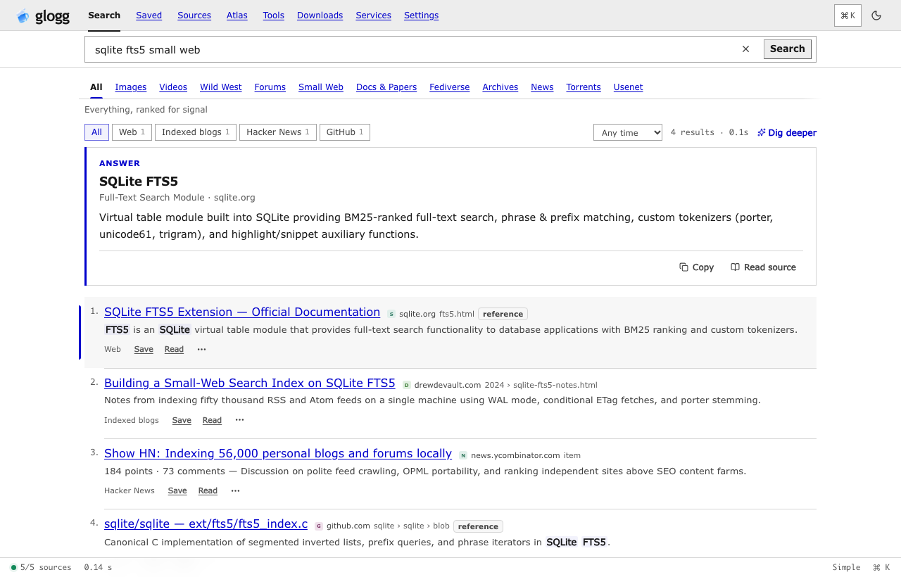
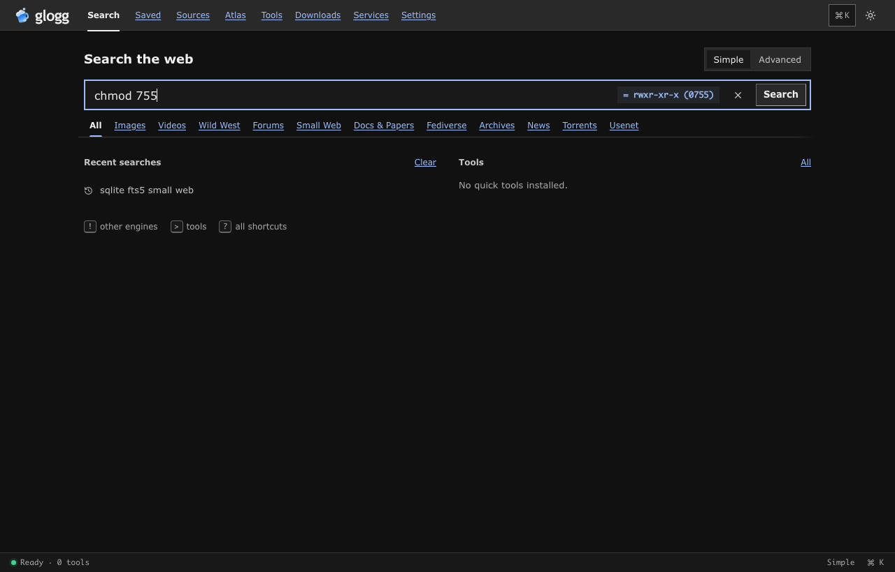

# Using glogg

A tour of glogg on your own machine, from the first search to downloads, tools and AI answers. For installation see [install.md](./install.md).

- [First search](#first-search)
- [Simple and Advanced views](#simple-and-advanced-views)
- [Scopes](#scopes)
- [Recent information](#recent-information)
- [Images and videos](#images-and-videos)
- [Saved library](#saved-library)
- [Install on iPhone](#install-on-iphone)
- [Choosing sources](#choosing-sources)
- [Search syntax](#search-syntax)
- [Keyboard](#keyboard)
- [Reading a page clean](#reading-a-page-clean)
- [Research: answers with citations (BYOK AI)](#research-answers-with-citations-byok-ai)
- [Downloads, debrid and cloud storage](#downloads-debrid-and-cloud-storage)
- [Torrents and Usenet search](#torrents-and-usenet-search)
- [Tools](#tools)
- [The deep index](#the-deep-index)
- [Making it yours](#making-it-yours)
- [18+ mode](#18-mode)
- [The CLI](#the-cli)
- [Use glogg as your browser's search engine](#use-glogg-as-your-browsers-search-engine)

## First search

Open <http://localhost:4173> and type a query. Glogg asks the enabled sources for the selected scope, shows ready results, then fills in as slower sources answer without reshuffling what you're reading. Speed and coverage depend on the sources that answer.



From the top:

1. **The answer.** Calculations, unit conversions, Unix `chmod` permissions (`chmod 755`), TCP/UDP port lookups (`port 5432`), display aspect ratios (`1920x1080`), offline Base64/URL/JWT decoders, definitions, accepted Stack Exchange answers and encyclopedia facts, with their sources. Simple calculations also preview right inside the search box (`= rwxr-xr-x (0755)`) with one-click copy before you even submit.
2. **Results.** Real sites, one or two per domain, with sponsored, affiliate and SEO-farm pages hidden. Official docs, accepted answers and first-hand posts rank first.
3. **The status bar.** How many sources answered and how fast. Click it to see each source, including ones that came back empty and why (a captcha, a rate limit, not set up).



Many sources can be tried without a key. Others require a configured service or credentials (for example **Brave Search**, **Mojeek Search**, and **Kagi Search** in **Settings → Keys**); quotas and upstream availability still apply. The source breakdown reports missing configuration and refusals.

## Simple and Advanced views

Press <kbd>m</kbd> to switch.

- **Simple** is one search box and one column: answer, then sites.
- **Advanced** adds a rail with scopes, sources, filters, how strict the junk filter is, the ranking signals behind each result, and **Research**.

## Scopes

Narrow a search to one corner of the web. Pick a scope under the search box or in the Advanced rail:

| Scope | What it searches |
| :--- | :--- |
| All | General web results, ranked for relevance and source diversity |
| Images | Wikimedia Commons images, with credits and license links |
| Videos | Wikimedia Commons videos, with an inline player and source links |
| Wild West | Imageboards, chan archives, old forums and webrings |
| Forums | Lemmy, Discourse, Stack Exchange, Hacker News, Lobsters, Tildes, classic forums |
| Small Web | Personal sites and blogs: Marginalia, Mwmbl, Wiby, Kagi Small Web, the 512KB Club |
| Docs & Papers | Official documentation, OpenAlex, arXiv, Crossref, Europe PMC |
| Fediverse | Mastodon, Bluesky, Lemmy |
| Archives | The Internet Archive, Wayback Machine and Open Library book metadata |
| News | Recent indexed reporting via GDELT and supported web providers |
| Torrents | DHT and Torznab indexers |
| Usenet | Newznab indexers and NZB.life |

## Recent information

Use **News** or include words such as “latest” or “today” when freshness matters. Glogg requests recent provider results, keeps source caches to at most a minute, and shows when sources were checked and fetched. **Check again** repeats the search within the same provider/cache limits. Publication dates and GDELT's indexed dates are labelled separately. Providers can index late or refuse requests; these labels do not promise complete real-time coverage.

## Images and videos

Choose **Images** or **Videos** under the search field. These tabs currently search Wikimedia Commons. Open a thumbnail to view an image, zoom it, or press **Play video**. Arrow controls step between results; **Escape**, **Close**, or browser navigation closes the viewer and stops playback. **Source** opens the original credit page; **Save** bookmarks that page locally.

Thumbnails and images are fetched through Glogg. Large originals fall back to a smaller preview, with the original available at its source. Video connects directly to Wikimedia only after Play; codec support varies by browser. Attribution and license links remain visible. Media needs a connection and is not included in the offline PWA cache.

## Saved library

Use the bookmark button on a result to save its title, address and snippet. Open **Saved** in the navigation to search or sort your collection, open a page in the clean reader, remove a bookmark, or export the library as JSON.

Saved items live in this browser on this device. They are not an account, a server backup, an offline copy of an article, or a sync service. Clearing the site's browser data removes them; export a copy before doing so. The interface reports storage errors instead of claiming a bookmark was saved.

## Install on iPhone

Open your glogg instance over HTTPS in Safari. Choose **Share → Add to Home Screen**, leave **Open as Web App** enabled if offered, then tap **Add**. Open glogg from its Home Screen icon and let it finish loading once while online. The same app also works in an ordinary browser tab; installation is optional.

The installed app uses the existing glogg icon, respects light/dark appearance, and leaves room for the screen's safe areas. Its interface and locally saved link metadata can open offline after a successful first load. Search, the reader and opening the original pages need a connection; glogg does not download articles for offline reading.

When a new version is ready, **Update ready → Reload** applies it. Until then the open session keeps its current version. The offline cache contains only the application's static files, never search responses, query URLs, API responses or reader content. Browser-local history, preferences and Saved items still follow their existing storage settings. A Home Screen installation may have separate storage from Safari; glogg does not promise synchronization between them.

For self-hosting, `npm run build` includes the offline worker. Serve `/sw.js` and `/site.webmanifest` from the same origin and allow them to revalidate on updates. HTTPS is required outside localhost.

## Choosing sources

Open **Sources** to browse the 28-connector catalogue, search by name, filter by category, and switch individual sources on or off. Keyed independent web engines (**Brave Search API**, **Mojeek Search API**, and **Kagi Search API**) activate automatically as soon as you save their API key in **Settings → Keys** (or `BRAVE_API_KEY`, `MOJEEK_API_KEY`, `KAGI_API_KEY`). Preferences persist in this browser and apply to subsequent searches. A source can still be unavailable because of its scope, required setup, provider quota or the server operator's public-service policy; the search status breakdown explains refusals and missing configuration.

Crossref and Europe PMC run in **Docs & Papers**; Open Library runs in **Archives**. The public service disables private indexers and disables Open Library unless its operator explicitly enables it. Public mode also hides server tools, downloads, research and administration. See the [public hosting guide](public-service.md) for the service boundary.

## Search syntax

| Type | Does |
| :--- | :--- |
| `"exact phrase"` | Only results containing the phrase |
| `-word` | Leave out results with the word |
| `site:sqlite.org wal` | Only that site, every page of it |
| `-site:pinterest.com` | Never that site |
| `filetype:pdf`, `inurl:docs`, `before:2022` | Passed to web engines that understand them |
| `chmod 755`, `port 5432`, `1920x1080`, `jwt eyJ…`, `base64 encode …` | Zero-network instant developer & workbench computations |
| `!w turing` | A **bang**: jump straight to another engine (`!w` Wikipedia, `!gh` GitHub, `!rfc`, `!cve`, `!man`, `!crates`, `!docsrs`, `!pypi`, `!go`, `!aur`, `!mdn`, `!4p` and 60+ more; add your own in Settings → Bangs) |
| `>dns example.com` | Run a **tool** directly ([list below](#tools)) |

Sources that don't understand operators get the plain words; web engines get the query as you typed it.

## Keyboard

| Key | Does |
| :--- | :--- |
| <kbd>/</kbd> | Focus the search box |
| <kbd>⌘K</kbd> / <kbd>Ctrl K</kbd> | Command palette: every view, scope, toggle and tool |
| <kbd>j</kbd> <kbd>k</kbd> | Next / previous result |
| <kbd>↵</kbd> | Open the result |
| <kbd>r</kbd> | Read it clean |
| <kbd>d</kbd> | Send to downloads |
| <kbd>m</kbd> | Simple / Advanced view |
| <kbd>?</kbd> | Show every shortcut |
| <kbd>Esc</kbd> | Close |

Single-key shortcuts can be turned off in Settings → Keyboard. Every section has its own address (`/atlas`, `/tools`, `/downloads`, `/services`, `/settings`), so Back, Forward and ⌘-click work.

## Reading a page clean

Press <kbd>r</kbd> on a result (or **Read** in its menu). glogg fetches the page on the server and shows only the text: no scripts, trackers, cookie banners, popups or affiliate links, and the page's primary sources (papers, RFCs, repositories) listed on their own. The site never sees your browser, and no `Referer` leaks your search.

## Research: answers with citations (BYOK AI)

In the Advanced view, **Research** reads the top pages for your question and writes an answer with numbered citations you can click.

- **Without a model** it quotes the most relevant passages, still cited.
- **With a model** it writes a proper answer. Set one on the **Tools** page → **AI** → settings:

| Provider | What to enter |
| :--- | :--- |
| Ollama (local) | Provider: Ollama. No key. Run `ollama pull llama3.1` first. Base URL defaults to `http://localhost:11434/v1` |
| LM Studio (local) | Provider: LM Studio. No key. Start its local server |
| OpenAI, Anthropic, OpenRouter, Groq, Mistral, DeepSeek, Together | Your API key; model optional (each has a default) |
| Anything OpenAI-compatible (vLLM, llama.cpp, LocalAI…) | Provider: Custom (OpenAI-compatible), plus its Base URL, model and key if it needs one |

Keys are stored on your glogg server (`~/.glogg/plugins.json`, mode 600) and never sent back to the browser. Page text goes to the model you chose and nowhere else; glogg tells the model to ignore instructions found inside pages.

If glogg runs in Docker and Ollama on the same Mac or PC, use `http://host.docker.internal:11434/v1` as the Base URL (on Linux, also add `extra_hosts: ["host.docker.internal:host-gateway"]` to the glogg service).

## Downloads, debrid and cloud storage

Every magnet, torrent, NZB and link has a **Send** button (or press <kbd>d</kbd>). glogg routes it to the first destination that's set up, and the **Downloads** page tracks it.

| Destination | Set it up in | You need |
| :--- | :--- | :--- |
| [Offcloud](https://offcloud.com) | Settings → Keys and services | API key (offcloud.com → Account → API) |
| aria2 | Settings → Keys and services | RPC URL and secret (the services stack creates one) |
| [Nextcloud](https://nextcloud.com) | Settings → Keys and services | Server URL, user, an **app password** (Nextcloud → Settings → Security) and a folder |
| [Real-Debrid](https://real-debrid.com) | Tools → Real-Debrid → settings | API token (real-debrid.com/apitoken) |
| [TorBox](https://torbox.app) | Tools → TorBox → settings | API key |
| [pCloud](https://www.pcloud.com) | Tools → pCloud → settings | Access token, region (US/EU) and upload folder |
| SABnzbd | Tools → SABnzbd → settings | URL and API key (SABnzbd → Config → General) |
| This machine | Nothing | Saved to `~/Downloads/glogg` (`GLOGG_DOWNLOADS_DIR`) |

Once a debrid or storage plugin is set up, it shows in the Send menu so you can pick it directly. Downloads saved locally never leave the downloads folder, whatever the link calls itself, and never overwrite a file.

## Torrents and Usenet search

The **Torrents** and **Usenet** scopes search:

- the public DHT and the Internet Archive's torrents, out of the box;
- your own [Bitmagnet](https://bitmagnet.io) (from the services stack);
- a **Torznab** indexer (Prowlarr, Jackett) and a **Newznab** one (NZBHydra2): Settings → Keys and services → Indexers;
- [NZB.life](https://nzb.life): Settings → Keys and services → NZB.life (API key).

Results show size, seeders or age, and health warnings (fake video stubs, `.exe` in a "movie"). Send hands them to your debrid service, aria2 or SABnzbd.

## Tools

The **Tools** page lists every tool; each also runs from any search box with `>` and its trigger.

| Area | Triggers |
| :--- | :--- |
| OSINT | `>dns`, `>whois`, `>subs` (subdomains), `>ip`, `>user` (username footprint), `>wb` (Wayback history), `>img` (reverse image search), `>dork` |
| Website testing | `>headers` (security headers), `>tls`, `>speed` (PageSpeed), `>seo`, `>links` (broken links), `>tech` (tech stack), `>mail` (SPF/DMARC), `>ping` |
| Debrid & storage | `>rd` Real-Debrid, `>tb` TorBox, `>oc` Offcloud, `>nc` Nextcloud, `>pcloud` |
| Usenet | `>nzb` NZB.life, `>sab` SABnzbd |
| Utilities | `>hash`, `>b64`, `>jwt`, `>ts` (timestamps), `>uuid`, `>magnet` (inspect a magnet) |
| AI | `>ai <prompt>` |

Every tool is a plugin, and you can write your own in a few minutes: see [plugins.md](./plugins.md).

## The deep index

glogg keeps its own index of the web big engines bury: about 43,000 personal blogs, imageboard catalogs, ~9,800 Lemmy communities, ~950 Discourse forums and 100 Stack Exchange sites.

1. Open **Atlas → Deep index**.
2. Press **Build the deep index**. Crawling is off until you do.
3. Keep searching; deep results appear as the crawl progresses. A first pass takes 3–4 hours and 1–1.5 GB.

The crawl is polite (one request per site at a time, a second apart, conditional requests, `Retry-After` honored), runs in the background and resumes after a restart. Add any feed, forum or board under **Atlas → Deep index → Add a source**.

## Making it yours

| Want | Where |
| :--- | :--- |
| Always see (or never see) a site | A result's ⋯ menu, or Settings → Domains: **pin**, **raise**, **lower**, **hide** |
| A stricter or looser junk filter, results per site | Settings → Search / Results |
| Hide phrases | Settings → Search → Hidden phrases |
| Turn sources on or off | Settings → Sources |
| Your own bangs | Settings → Bangs |
| Theme, accent, density, site icons | Settings → Appearance |
| Search history on or off | Settings → History |
| Same settings in another browser | Settings → Your settings: export/import a file, or save on your glogg and load elsewhere |

## 18+ mode

Off by default. Settings → 18+ mode turns it on after a confirmation: SafeSearch off upstream, adult boards and indexers included. The 18+ pill turns it off again. Sources advertising sexual material involving minors are never indexed or shown, in any mode.

## The CLI

```bash
npm run cli -- search "ubuntu linux" --lens forums
npm run cli -- search "debian iso" --lens p2p-magnet --json
npm run cli -- inspect https://example.com/article
npm run cli -- atlas
npm run cli -- query-plan "rust async runtime"
npm run cli -- rules > glogg.ublacklist      # a uBlacklist ruleset of known junk domains
npm run cli -- containers status
npm run cli -- --help
```

## Use glogg as your browser's search engine

glogg serves an OpenSearch description (`/opensearch.xml`), so Chrome-based browsers and Firefox can pick it up. To add it by hand, use this search URL:

```text
http://localhost:4173/?q=%s
```

- **Chrome / Edge / Brave:** Settings → Search engine → Manage → Add.
- **Firefox:** right-click the address bar on glogg → **Add "glogg"**.
- **Safari:** doesn't allow custom engines without an extension.

With a password set, your browser stays signed in for 30 days.
